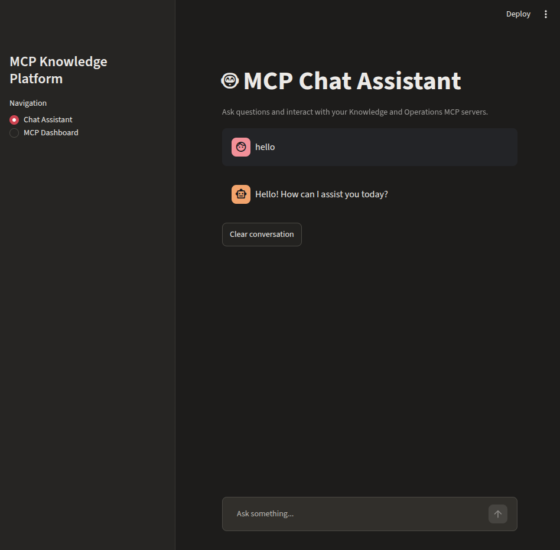
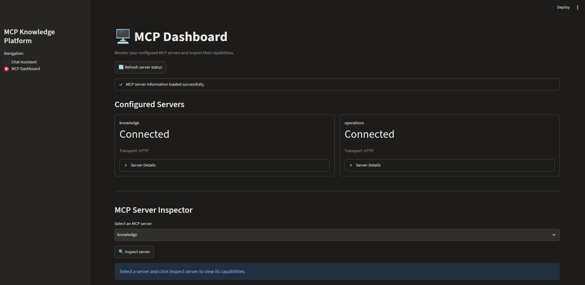
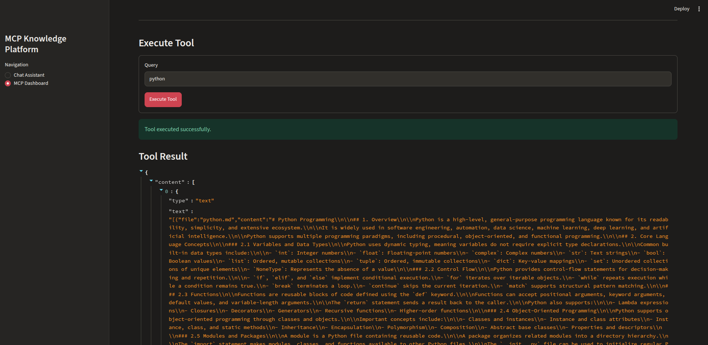

# MCP Knowledge & Operations Platform

A hands-on Model Context Protocol (MCP) platform built with **Python**, **FastMCP**, and **LangChain**. It demonstrates how AI applications can discover and use external capabilities through MCP, including knowledge retrieval, structured tools, resources, prompts, and controlled operations.

The project also includes a Streamlit interface for interacting with an MCP-powered AI assistant and inspecting MCP servers.

## Overview

The platform is organized around two MCP servers and an MCP client layer:

- **Knowledge Server** — exposes searchable knowledge, resources, resource templates, and research prompts.
- **Operations Server** — provides calculation, data processing, validation, and controlled file-system operations.
- **MCP Client** — connects to configured servers, discovers their capabilities, and invokes tools or retrieves MCP data.
- **Streamlit Application** — provides a chat interface and an interactive dashboard for inspecting servers and executing tools.


## Screenshots

### Chat Assistant



### MCP Dashboard



### Tool Execution




## Architecture

```text
                    Streamlit Application
                    ┌─────────────────────┐
                    │                     │
                    │   Chat Assistant   │
                    │   MCP Dashboard    │
                    │                     │
                    └──────────┬──────────┘
                               │
                    ┌──────────▼──────────┐
                    │   Application Layer │
                    │                     │
                    │    AgentService     │
                    │   DashboardService  │
                    └──────────┬──────────┘
                               │
                    ┌──────────▼──────────┐
                    │     MCP Client      │
                    │                     │
                    │ Connection Manager  │
                    │ Capability Discovery│
                    │ Tool Execution      │
                    │ Resource Retrieval │
                    │ Prompt Retrieval   │
                    └───────┬───────┬─────┘
                            │       │
                 ┌──────────▼─┐   ┌─▼────────────┐
                 │  Knowledge │   │  Operations  │
                 │   Server   │   │    Server    │
                 ├────────────┤   ├──────────────┤
                 │ Search     │   │ Calculation  │
                 │ Resources  │   │ Data Analysis│
                 │ Templates  │   │ Validation   │
                 │ Prompts    │   │ File System  │
                 └────────────┘   └──────────────┘
```

## Features

### 1. Knowledge Server

Provides knowledge-oriented capabilities through MCP:

- **Search Tool** — searches the project's knowledge base.
- **Resources** — exposes structured knowledge content.
- **Resource Templates** — provides parameterized resource access.
- **Research Prompts** — exposes reusable prompts for research workflows.

Knowledge documents are stored under `data/knowledge/`.

### 2. Operations Server

Provides structured tools for performing controlled operations:

| Tool | Description |
|---|---|
| `calculate` | Evaluates supported mathematical expressions. |
| `analyze_numbers` | Calculates statistical information from numerical data. |
| `validate_data` | Validates input data against predefined schemas. |
| `list_files` | Lists entries inside the configured workspace. |
| `read_file` | Reads files from the configured workspace. |
| `write_file` | Writes or updates files inside the workspace. |
| `get_file_info` | Retrieves file metadata. |

File-system operations are restricted to a configured workspace and include path validation to prevent directory traversal.

### 3. MCP Client

The client layer manages connections and communication with configured MCP servers.

Its responsibilities include:

- Loading and validating MCP client configuration.
- Connecting to multiple MCP servers.
- Managing connection lifecycles.
- Discovering tools, resources, resource templates, and prompts.
- Executing tools with arguments.
- Retrieving resources and prompts.

The connection manager uses asynchronous resource management to ensure that client sessions are properly released.

### 4. AI Chat Assistant

The application includes an AI assistant built with LangChain and Groq.

The assistant can use tools discovered from the configured MCP servers to interact with the platform's capabilities.

The model configuration is kept separate from MCP server implementations.

### 5. MCP Dashboard

The Streamlit dashboard provides an interactive interface for working with MCP servers.

It supports:

- Viewing configured MCP servers and their connection status.
- Inspecting server details.
- Discovering available tools.
- Inspecting tool descriptions and input schemas.
- Discovering resources and resource templates.
- Discovering available prompts.
- Selecting a tool and dynamically generating input fields from its JSON input schema.
- Providing arguments and executing tools directly from the dashboard.
- Viewing tool execution results and errors.

## Technology Stack

| Technology | Purpose |
|---|---|
| Python 3.14+ | Core programming language |
| FastMCP | MCP server and client implementation |
| MCP | Standardized communication between AI applications and external capabilities |
| LangChain | Agent orchestration and MCP tool integration |
| LangChain-Groq | Groq model integration |
| Streamlit | Interactive application interface |
| Pydantic | Data validation and structured schemas |
| Pydantic Settings | Application configuration |
| NumPy | Numerical analysis |
| uv | Python dependency and project management |
| pytest | Automated testing |
| Ruff | Code formatting and linting |

## Project Structure

```text
.
├── config/
│   └── mcp_servers.json
│
├── data/
│   └── knowledge/
│
├── src/
│   └── mcp_mastery/
│       ├── application/
│       │   ├── agent_service.py
│       │   └── dashboard_service.py
│       │
│       ├── client/
│       │   ├── config.py
│       │   ├── loader.py
│       │   └── manager.py
│       │
│       ├── knowledge_server/
│       ├── operations_server/
│       ├── config/
│       └── ui/
│           ├── chat_page.py
│           └── dashboard_page.py
│
├── tests/
│   ├── integration/
│   ├── transport/
│   └── unit/
│
├── app.py
├── agent_demo.py
├── pyproject.toml
├── uv.lock
└── README.md
```

## Getting Started

### Prerequisites

- Python 3.14 or later
- [uv](https://docs.astral.sh/uv/)
- A Groq API key for the AI chat assistant

### 1. Clone the repository

```bash
git clone https://github.com/ahmadrezabaqerzade/mcp-knowledge-operations-platform.git

cd mcp-knowledge-operations-platform
```

### 2. Install dependencies

```bash
uv sync --all-groups
```

### 3. Configure environment variables

Create a `.env` file in the project root and configure the Groq API key required by the AI assistant.

```dotenv
GROQ_API_KEY=your_groq_api_key
```

Do not commit `.env` or expose API keys in source control.

### 4. Configure MCP servers

The MCP client configuration is stored in:

```text
config/mcp_servers.json
```

The application uses this configuration to locate and connect to the Knowledge and Operations servers.

Make sure the configured server URLs and transport settings match the way the servers are started in your environment.

### 5. Start the MCP servers

Start the Knowledge Server and Operations Server using their configured HTTP endpoints.

The default local endpoints are:

```text
Knowledge Server:  http://127.0.0.1:8001/mcp
Operations Server: http://127.0.0.1:8002/mcp
```

Both servers must be available before using the dashboard or chat assistant.

### 6. Run the Streamlit application

```bash
uv run streamlit run app.py
```

Open the local URL printed by Streamlit in your browser.

## Using the Application

### Chat Assistant

1. Open the **Chat Assistant** page.
2. Enter a question or instruction.
3. The LangChain agent processes the request.
4. When appropriate, the agent uses tools exposed by the connected MCP servers.
5. The assistant displays its response.

### MCP Dashboard

1. Open the **MCP Dashboard** page.
2. Review the configured MCP servers and their connection status.
3. Select a server and inspect its capabilities.
4. Open the Tools section and choose a tool.
5. Review its description and input schema.
6. Enter the required arguments in the generated input fields.
7. Execute the tool and inspect the returned result.

## Testing

The project includes unit, integration, and transport-level tests.

Run the complete test suite:

```bash
uv run pytest -v
```

Run a specific test module:

```bash
uv run pytest -v tests/unit/application/test_dashboard_service.py
```

## Code Quality

Format the code:

```bash
uv run ruff format .
```

Check formatting:

```bash
uv run ruff format --check .
```

Run lint checks:

```bash
uv run ruff check .
```

## Design Principles

The project follows several architectural principles:

- **Separation of Concerns:** MCP servers, client infrastructure, application services, and UI components have distinct responsibilities.
- **Reusable Services:** Application logic is kept outside Streamlit presentation code.
- **Asynchronous Communication:** MCP client operations use asynchronous APIs.
- **Explicit Resource Management:** Client connections and sessions are managed through controlled lifecycle handling.
- **Input Validation:** Structured inputs are validated before operations are performed.
- **Controlled File Access:** File-system tools operate within a configured workspace.
- **Testability:** Core components are designed to support unit and integration testing.

## Project Status

This is an evolving hands-on engineering and learning project focused on understanding and implementing MCP-based systems.

The implementation is developed incrementally, with an emphasis on practical architecture, testing, integration, and maintainable Python code.

## License

This project is licensed under the MIT License. See [LICENSE](LICENSE) for details.
